# NetExpert 

[](https://netexpert.streamlit.app/)
[](https://share.streamlit.io/deploy?repository=zann06/NetExpert&branch=main&mainModule=app.py)
[](https://www.python.org/)
[](tests/)
[](assets/examples/laporan-contoh.pdf)

NetExpert adalah aplikasi web edukasi untuk mensimulasikan **sistem pakar berbasis aturan produksi IF–THEN**. Aplikasi ini tidak sekadar menampilkan kesimpulan: seluruh proses penalaran — evaluasi TRUE/FALSE setiap kondisi, conflict set, conflict resolution, refractoriness, dan pohon inferensi — dapat diaudit langkah demi langkah.

Aplikasi dibangun dengan **Python + Streamlit**. Inference engine terpisah sepenuhnya dari UI dan tidak menggunakan LLM atau API AI eksternal. Semua keputusan inferensi bersifat deterministik.

**Live demo:** <https://netexpert.streamlit.app/>

---

## 1. Fitur Utama

### Inference engine
- **Forward Chaining** (data-driven) dengan evaluasi seluruh kondisi IF pada setiap iterasi.
- **Backward Chaining** (goal-driven) dengan subgoal rekursif, pencatatan cabang gagal, dan deteksi siklus.
- **Operator AND/OR pada level aturan**: aturan AND membutuhkan semua kondisi TRUE, aturan OR cukup satu kondisi TRUE. Dataset tugas tetap memakai AND sehingga perilakunya tidak berubah.
- **Conflict resolution** tiga tingkat: `salience` → `spesifisitas` → `nomor aturan` (numerik, sehingga R2 sebelum R10).
- **Refractoriness**: setiap aturan hanya dapat fired sekali dalam satu eksekusi.
- **Duplicate conclusion handling**: kesimpulan yang sudah ada tidak diduplikasi, tetapi firing tetap dicatat.
- **Normalized exact matching**: trim, collapse whitespace, dan case-insensitive.

### Transparansi penalaran
- Setiap kondisi IF memiliki label eksplisit **TRUE** atau **FALSE**.
- Aturan **AND** dan **OR** sama-sama menampilkan status setiap kondisi, termasuk kondisi yang tidak menentukan hasil OR.
- Perbedaan tegas antara **NOT READY** (kondisi tidak memenuhi operator) dan **READY BUT NOT SELECTED** (kalah conflict resolution).
- Status **REFRACTORY** ditampilkan pada iterasi berikutnya.
- Iteration log lengkap: snapshot working memory, ranking conflict set, aturan terpilih, alasan pemilihan, kesimpulan, dan working memory setelah firing.
- Cabang yang gagal tetap terlihat, tidak disembunyikan.

### Visualisasi
- Inference tree dibangun **dinamis dari trace eksekusi** (bukan ilustrasi statis).
- **Graph interaktif yang dapat diklik** (`st-link-analysis` / Cytoscape): klik node untuk melihat detail evaluasi, kondisi, kesimpulan, atau cabang pembuktian langsung di bawah graph.
- Forward chaining ditampilkan **satu iterasi pada satu waktu** melalui selector agar graph tetap terbaca.
- Tersedia tab **Graph statis (DOT)** berbasis Graphviz untuk tampilan seluruh iterasi, pan/zoom, dan ekspor `.dot`.
- Pengelompokan per iterasi, label TRUE/FALSE pada edge dan node, legenda permanen.
- Filter pada graph statis: semua evaluasi, hanya FIRED, kondisi gagal, READY BUT NOT SELECTED.
- Tabel alternatif yang aksesibel dan inspector node tetap tersedia sebagai fallback teks.
- Unduh graph dalam format `.dot`.

### Laporan
- Halaman **Laporan** menyusun dokumen profesional hitam-putih dari hasil diagnosis aktif.
- Metadata **opsional**: judul, mata kuliah, kelompok, anggota + NIM + peran, dosen, institusi, logo, dan narasi.
- Layout A4 siap cetak: halaman sampul, bagian bernomor, tabel basis pengetahuan, hasil forward/backward, kesimpulan, dan lampiran jejak evaluasi.
- Pratinjau langsung di aplikasi serta unduhan **HTML** (siap *Print → Save as PDF*) dan **Markdown**.
- Contoh laporan jadi: [`assets/examples/laporan-contoh.pdf`](assets/examples/laporan-contoh.pdf) — 9 halaman A4 hitam-putih.
- Warna dokumen murni hitam-putih agar konsisten saat dicetak.

### Manajemen pengetahuan
- CRUD aturan produksi: tambah, edit ID/kondisi/kesimpulan/salience, hapus dengan konfirmasi.
- **Pemilihan operator AND atau OR** saat menambah/mengedit aturan.
- Validasi: ID unik, minimal satu kondisi, kesimpulan tidak kosong, salience 1–4, operator AND/OR.
- Pencarian dan filter berdasarkan teks/salience.
- Manajemen fakta awal: pilih dari katalog, tambah fakta manual, hapus, kosongkan, atau muat ulang fakta default.
- Reset seluruh aplikasi ke dataset tugas.

### Feedback jawaban
- Halaman **Feedback**: tempel jawaban tugas (mis. hasil diskusi dengan AI) dan aplikasi memeriksa setiap iterasi terhadap jejak engine — **deterministik, tanpa AI/LLM**.
- Dua mode input: **tempel jawaban bebas** (tabel markdown, baris `Iterasi 1: ...`, daftar bernomor) atau **form terstruktur** per iterasi.
- Pemeriksaan mencakup conflict set, aturan terpilih, dan kesimpulan per iterasi, plus iterasi yang hilang/berlebih dan klaim STOP.
- Setiap langkah keliru diberi penjelasan yang mengutip kriteria konkret: nilai salience, jumlah kondisi (spesifisitas), nomor aturan, atau refractoriness.
- Skor deterministik (jumlah field cocok / total field); jawaban benar setelah KB dimodifikasi akan dinilai terhadap KB baru, bukan dataset hardcoded.

### Antarmuka
- Tema **white-first** yang profesional: `#FFFFFF`, surface `#F8FAFC`, border `#E2E8F0`, aksen `#2563EB`.
- Warna semantik: hijau TRUE/PROVEN, merah FALSE/UNPROVEN, amber READY/evaluating, abu-abu refractory.
- Layout responsif, kartu minimalis, tabel rapi, tipografi Inter dengan fallback sistem.
- Tujuh halaman: Overview, Diagnosis, Knowledge Base, Inference Tree, Laporan, Feedback, Guide.

---

## 2. Dataset Default 

### Aturan produksi

| ID | IF (operator AND) | THEN | Salience |
|---|---|---|---:|
| R1 | Semua Situs Tidak Bisa Dibuka | Cek Router | 1 |
| R2 | Lampu Internet Router Merah | Gangguan Provider | 2 |
| R3 | Kecepatan Sangat Lambat | Gangguan Provider | 2 |
| R4 | Gangguan Provider AND Tagihan Sudah Dibayar | Lapor ke Provider | 3 |
| R5 | Perangkat Lain Juga Offline | Gangguan Provider | 2 |
| R6 | Semua Situs Tidak Bisa Dibuka AND Hanya Laptop Ini Bermasalah | Masalah pada Laptop | 3 |
| R7 | Gangguan Provider | Gunakan Tethering Sementara | 1 |
| R8 | Cek Router AND Router Terasa Panas | Matikan Router 10 Menit | 4 |

Salience: **1 = Rendah**, **2 = Sedang**, **3 = Tinggi**, **4 = Tertinggi**.

Kedelapan aturan default memakai operator **AND** agar sesuai tugas. Operator **OR** dapat dipilih untuk aturan baru melalui halaman Knowledge Base, misalnya `Lampu Internet Router Merah OR Kecepatan Sangat Lambat → Gangguan Provider`. Spesifisitas tetap dihitung dari jumlah kondisi, terlepas dari operatornya.

### Fakta awal
1. Semua Situs Tidak Bisa Dibuka
2. Perangkat Lain Juga Offline
3. Tagihan Sudah Dibayar

### Hasil forward chaining yang diharapkan

| Iterasi | Conflict set terurut | Terpilih | Kesimpulan |
|---:|---|---|---|
| 1 | R5, R1 | R5 | Gangguan Provider |
| 2 | R4, R1, R7 | R4 | Lapor ke Provider |
| 3 | R1, R7 | R1 | Cek Router |
| 4 | R7 | R7 | Gunakan Tethering Sementara |
| 5 | — | Stop | — |

Derived facts: `Gangguan Provider`, `Lapor ke Provider`, `Cek Router`, `Gunakan Tethering Sementara`.

R6, R8, R2, R3 tetap **NOT READY** pada skenario default karena fakta kondisinya tidak tersedia. Cabang gagal ini tetap ditampilkan pada log dan tree.

### Hasil backward chaining yang diharapkan
Goal `Lapor ke Provider` → **PROVEN** melalui:
- `R4`: `Gangguan Provider AND Tagihan Sudah Dibayar → Lapor ke Provider`
- `Gangguan Provider` dibuktikan oleh `R5` dari fakta `Perangkat Lain Juga Offline`
- `Tagihan Sudah Dibayar` sudah ada di fakta awal

Alternatif R2 dan R3 ditampilkan sebagai cabang **UNPROVEN**.

---

## 3. Teknologi

| Komponen | Teknologi |
|---|---|
| Bahasa | Python 3.10+ |
| Web UI | Streamlit |
| Graph interaktif | `st-link-analysis` (Cytoscape.js) |
| Graph statis | Graphviz DOT via `st.graphviz_chart` |
| Testing | Pytest |
| Data model | Python dataclasses |

Inference engine tidak mengimpor Streamlit. Tree renderer hanya mengonsumsi trace terstruktur dan tidak menjalankan ulang logika inferensi.

> Streamlit merender Graphviz menggunakan Graphviz WebAssembly di browser, sehingga **binary `dot` tidak wajib terinstal** di sistem. Ekspor `.dot` dihasilkan langsung dari string DOT yang sama, tanpa paket Python tambahan.

---

## 4. Struktur Proyek

```text
NetExpert_Documentation/
├── app.py                          # Entry point Streamlit
├── requirements.txt
├── pytest.ini
├── README.md                       # Dokumentasi utama (satu-satunya dokumen)
├── .gitignore
├── .streamlit/
│   └── config.toml                 # Tema white-first
├── scripts/
│   └── make_report_previews.py     # Render ulang pratinjau PDF contoh di README
├── assets/
│   ├── screenshots/                # Tangkapan layar untuk README
│   └── examples/
│       └── laporan-contoh.pdf      # Contoh laporan 9 halaman (A4)
├── src/
│   ├── __init__.py
│   ├── models.py                   # Rule, trace, node, result models
│   ├── normalization.py            # Normalized exact matching
│   ├── working_memory.py           # Ordered fact set
│   ├── knowledge_base.py           # Default dataset + CRUD
│   ├── validation.py               # Rule/fact validation
│   ├── inference/
│   │   ├── __init__.py
│   │   ├── conflict_resolution.py  # Salience → specificity → numeric ID
│   │   ├── forward_chaining.py
│   │   └── backward_chaining.py
│   ├── visualization/
│   │   ├── __init__.py
│   │   ├── inference_tree.py       # Dynamic DOT + accessible tables
│   │   └── interactive_graph.py    # Clickable Cytoscape elements + styles
│   ├── report/
│   │   ├── __init__.py
│   │   ├── models.py               # Optional report metadata (group, NIM, ...)
│   │   └── render.py               # Monochrome HTML + Markdown report renderer
│   ├── feedback/
│   │   ├── __init__.py
│   │   ├── models.py               # Submitted iterations + feedback report
│   │   ├── parser.py               # Parse pasted answers (tables / free lines)
│   │   └── checker.py              # Deterministic comparison vs engine trace
│   └── ui/
│       ├── __init__.py
│       ├── styles.py               # Global white-first CSS
│       ├── state.py                # Session state + callbacks
│       ├── components.py           # Reusable HTML components
│       └── pages/
│           ├── __init__.py
│           ├── overview.py
│           ├── diagnosis.py
│           ├── knowledge_base.py
│           ├── tree.py
│           ├── report.py           # Report builder + live preview + downloads
│           ├── feedback.py         # Answer checker (paste answer / form)
│           └── guide.py
└── tests/
    ├── conftest.py
    ├── test_normalization.py
    ├── test_knowledge_base.py
    ├── test_conflict_resolution.py
    ├── test_forward_chaining.py
    ├── test_backward_chaining.py
    ├── test_tree.py
    ├── test_or_rules.py
    ├── test_interactive_graph.py
    ├── test_report.py
    └── test_feedback.py
```

---

## 5. Instalasi (Windows PowerShell)

```powershell
cd C:\project\NetExpert_Documentation

# Buat virtual environment (opsional, disarankan)
python -m venv .venv
.\.venv\Scripts\Activate.ps1

# Jika PowerShell memblokir aktivasi:
# Set-ExecutionPolicy -Scope Process -ExecutionPolicy Bypass

python -m pip install --upgrade pip
python -m pip install -r requirements.txt
```

Jika ingin menjalankan tanpa virtual environment:

```powershell
python -m pip install -r requirements.txt
```

---

## 6. Menjalankan Aplikasi

```powershell
python -m streamlit run app.py
```

atau:

```powershell
streamlit run app.py
```

Streamlit akan membuka browser pada `http://localhost:8501`. Hentikan server dengan `Ctrl + C`.

Opsi port khusus:

```powershell
python -m streamlit run app.py --server.port 8501
```

---

## 7. Tangkapan Layar & Alur Kerja

Alur pemakaian: **Overview → Diagnosis → Hasil → Inference Tree → Laporan → Knowledge Base → Guide**.

### 7.1 Overview

Ringkasan dataset, metrik knowledge base, dan tombol jalan cepat.

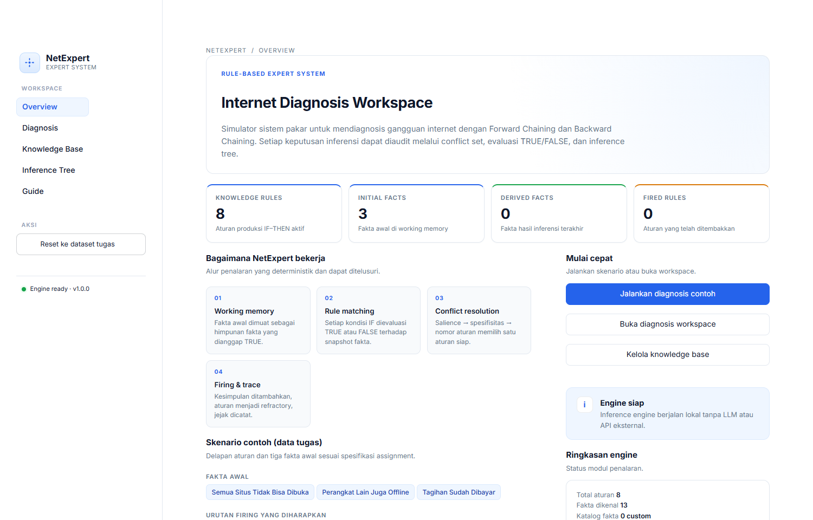

### 7.2 Menyiapkan Diagnosis

Tiga fakta default sudah terpilih. Pilih metode inferensi di panel kanan, lalu tekan **Jalankan inferensi**.

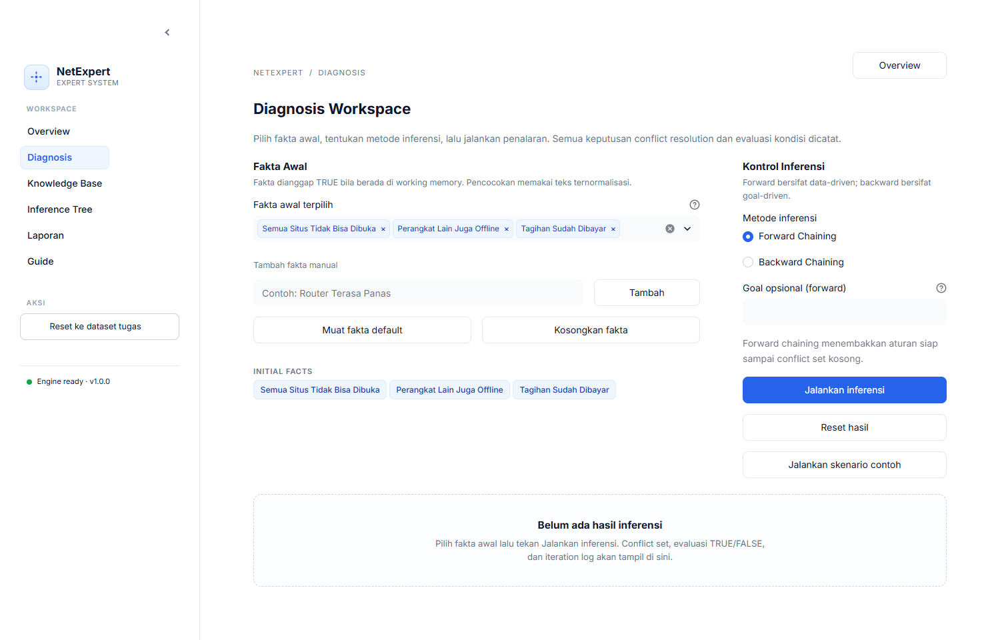

### 7.3 Hasil Forward Chaining

Urutan firing **R5 → R4 → R1 → R7**, empat fakta turunan, dan ringkasan iterasi.

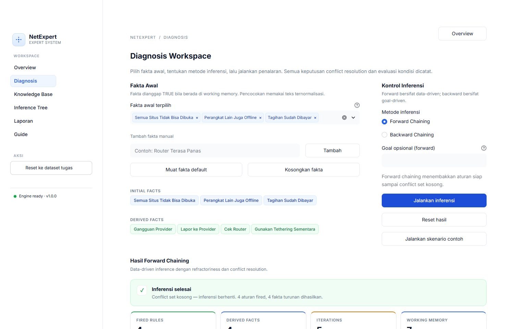

### 7.4 Pohon Inferensi Forward

Pohon dibangun dari trace eksekusi. Tab **Graph interaktif** menampilkan satu iterasi pada satu waktu dan mengirim event klik node; detail node muncul di bawah graph. Tab **Graph statis (DOT)** menampilkan seluruh iterasi, filter evaluasi, dan unduhan `.dot`. Setiap kondisi berlabel TRUE/FALSE dan cabang gagal tetap terlihat.

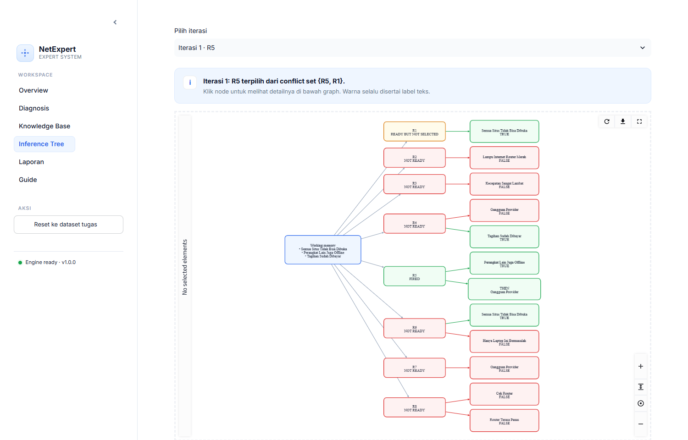

Tab statis menampilkan seluruh iterasi sekaligus, lengkap dengan filter evaluasi dan ekspor `.dot`:

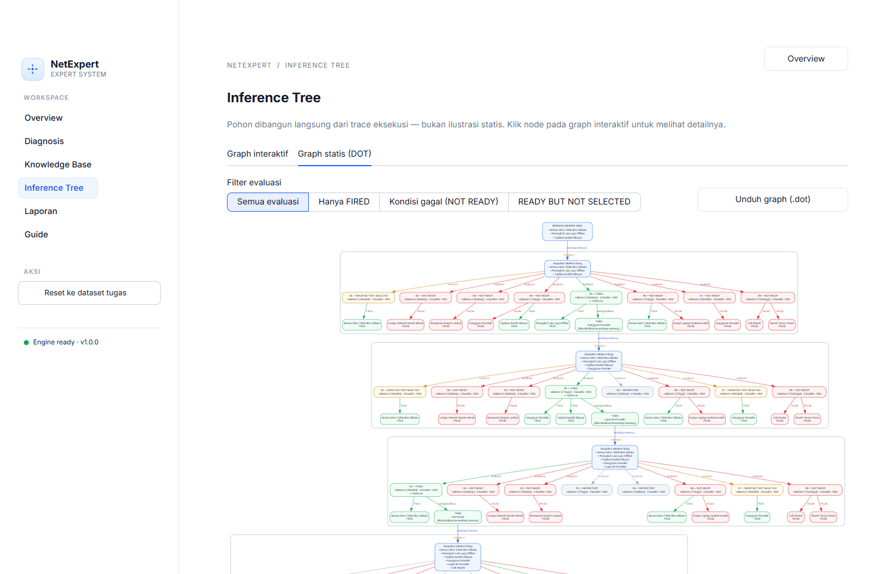

### 7.5 Backward Chaining

Goal `Lapor ke Provider` berhasil dibuktikan melalui **R5 → R4**. Cabang alternatif yang gagal tetap dicatat.

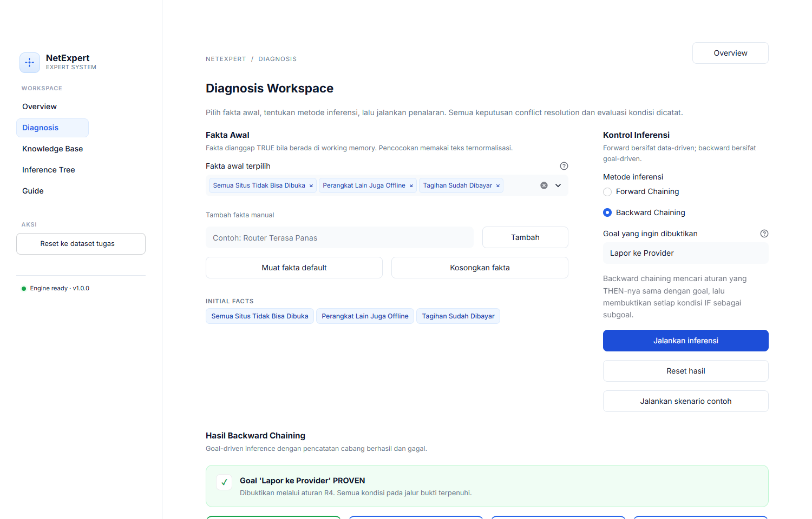

### 7.6 Pohon Inferensi Backward

Visualisasi goal, rule, dan fakta pendukung beserta status PROVEN/UNPROVEN. Graph interaktif menampilkan seluruh pohon pembuktian dan detail node saat diklik; edge diberi label operator AND/OR.

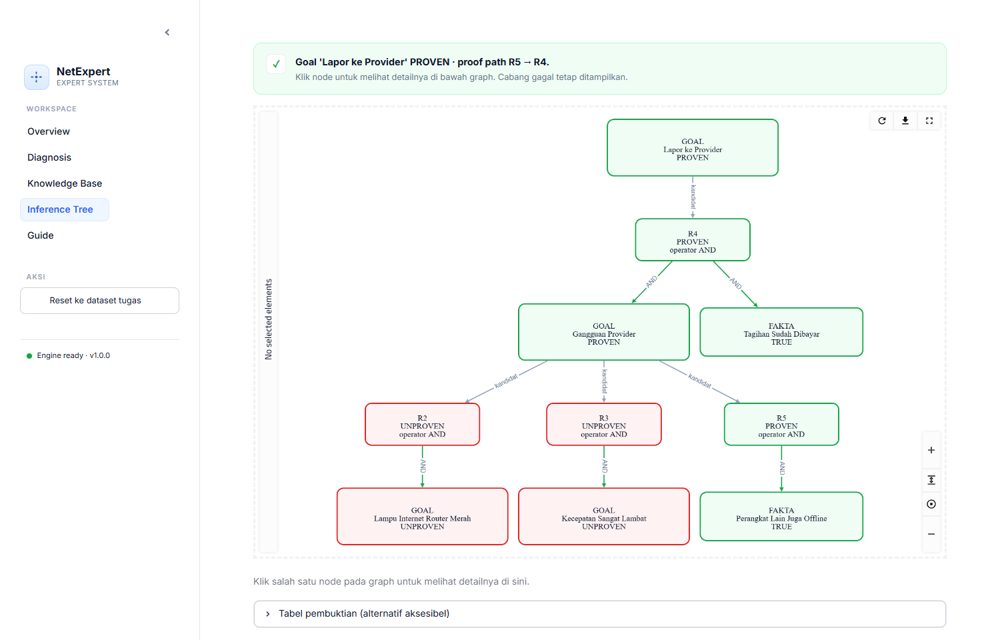

Tampilan statis (DOT) untuk seluruh pohon pembuktian:

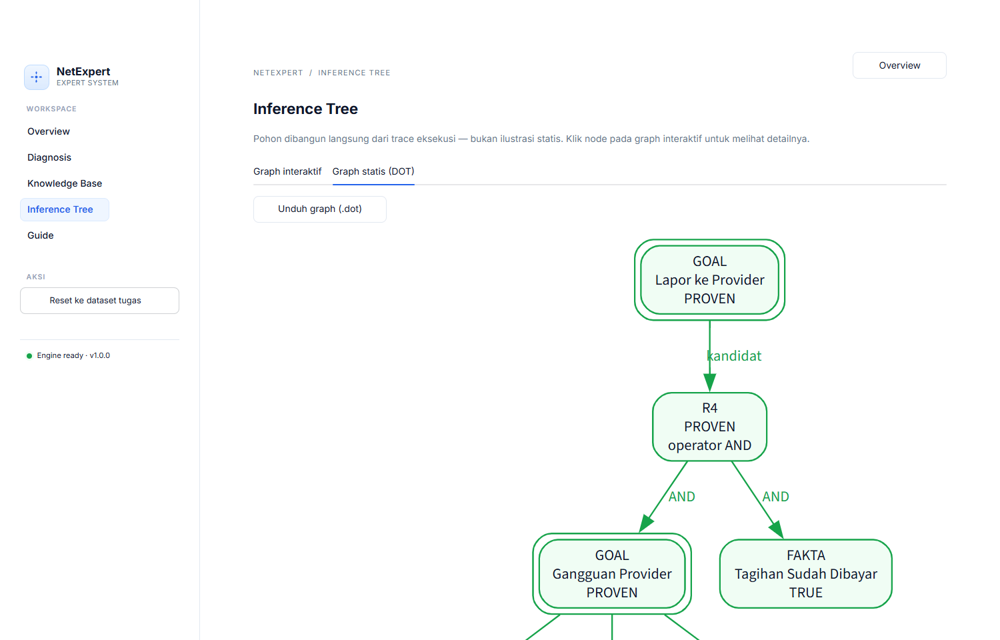

### 7.7 Knowledge Base

CRUD aturan produksi, validasi ID unik, pemilihan operator AND/OR, pencarian, dan filter salience.

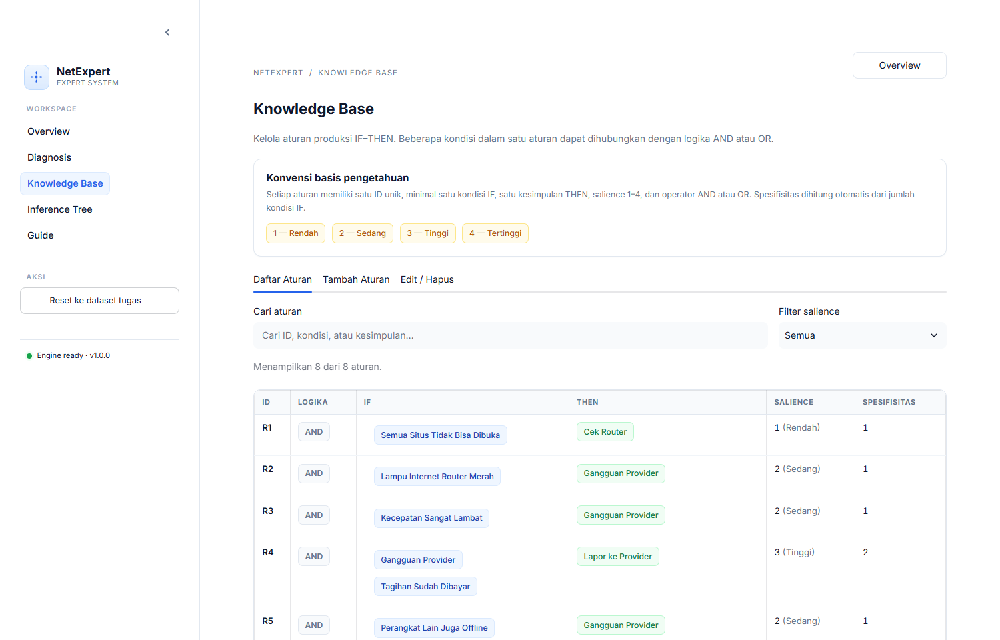

### 7.8 Guide

Penjelasan konsep forward/backward chaining, conflict resolution, dan refractoriness langsung di dalam aplikasi.

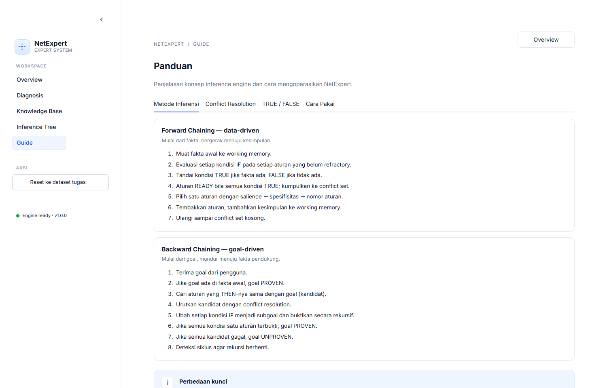

### 7.9 Laporan Profesional

Halaman **Laporan** menggabungkan metadata opsional (kelompok, anggota, NIM, dosen, institusi, logo) dengan hasil inferensi aktif. Pratinjau dokumen hitam-putih tampil langsung di samping formulir, dan laporan dapat diunduh sebagai HTML siap cetak atau Markdown.

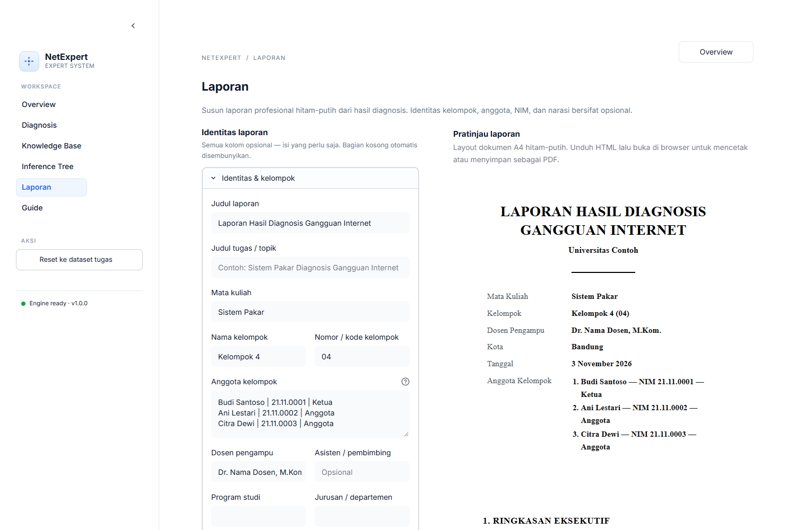

### 7.10 Contoh Laporan yang Dihasilkan

**Contoh lengkap (PDF, 9 halaman A4):** [**`laporan-contoh.pdf`**](assets/examples/laporan-contoh.pdf) — dihasilkan dari dataset default dengan urutan firing **R5 → R4 → R1 → R7**.

Struktur dokumen: halaman sampul → ringkasan eksekutif → pendahuluan → basis pengetahuan dan fakta awal → hasil forward chaining → kesimpulan dan rekomendasi → lampiran jejak evaluasi lengkap. Pratinjau keseluruhan halaman:

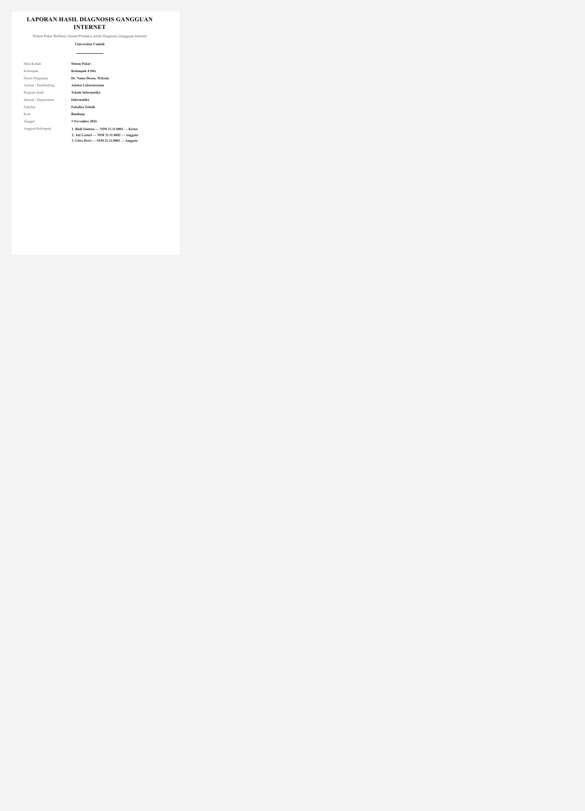

Halaman sampul menampilkan identitas kelompok dan anggota beserta NIM. Bagian hasil memuat urutan firing, conflict set per iterasi, kesimpulan, fakta turunan, dan working memory akhir — semuanya dalam tabel hitam-putih. Seluruh kolom metadata bersifat opsional: baris yang kosong otomatis disembunyikan.

| Halaman sampul | Hasil forward chaining |
|---|---|
| 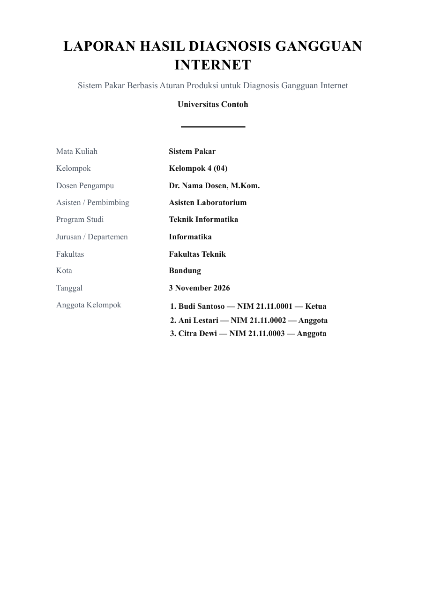 | 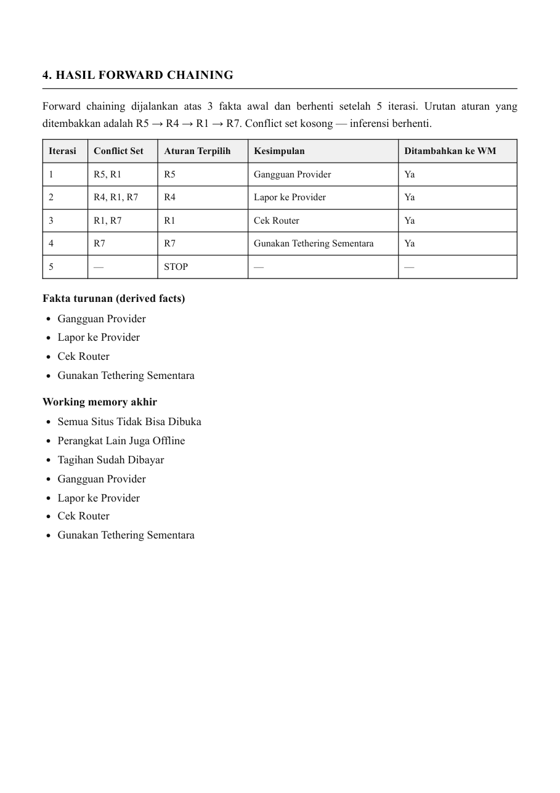 |

> Pratinjau halaman PDF di atas dirender ulang kapan saja dengan `python scripts/make_report_previews.py`.

Cuplikan Markdown yang dihasilkan (format unduhan `.md`):

```markdown
# Laporan Hasil Diagnosis Gangguan Internet

_Sistem Pakar Berbasis Aturan Produksi untuk Diagnosis Gangguan Internet_

**Universitas Contoh**

- **Mata Kuliah:** Sistem Pakar
- **Kelompok:** Kelompok 4 (04)
- **Dosen Pengampu:** Dr. Nama Dosen, M.Kom.
- **Anggota Kelompok:**
    - Budi Santoso — NIM 21.11.0001 — Ketua
    - Ani Lestari — NIM 21.11.0002 — Anggota
    - Citra Dewi — NIM 21.11.0003 — Anggota

## 1. Ringkasan Eksekutif
...
## 4. Hasil Forward Chaining

| Iterasi | Conflict Set | Aturan Terpilih | Kesimpulan | Ditambahkan ke WM |
| --- | --- | --- | --- | --- |
| 1 | R5, R1 | R5 | Gangguan Provider | Ya |
| 2 | R4, R1, R7 | R4 | Lapor ke Provider | Ya |
| 3 | R1, R7 | R1 | Cek Router | Ya |
| 4 | R7 | R7 | Gunakan Tethering Sementara | Ya |
| 5 | — | STOP | — | — |
```

---

## 8. Cara Menggunakan

### A. Menjalankan diagnosis default
1. Buka halaman **Overview**, tekan **Jalankan diagnosis contoh**, atau buka **Diagnosis**.
2. Fakta default sudah terpilih: tiga fakta tugas.
3. Pilih metode **Forward Chaining**.
4. Tekan **Jalankan inferensi**.
5. Periksa urutan firing, conflict set, dan iteration log.
6. Buka **Inference Tree** untuk melihat cabang TRUE/FALSE.

### B. Menguji cabang gagal
1. Pada **Diagnosis**, jalankan forward chaining dengan fakta default.
2. Buka iteration log iterasi 1.
3. Perhatikan:
   - **R6 NOT READY** karena `Hanya Laptop Ini Bermasalah` = FALSE.
   - **R8 NOT READY** karena `Router Terasa Panas` = FALSE.
   - **R1 READY BUT NOT SELECTED** karena kalah salience dari R5.

### C. Menambah fakta dan mengubah hasil
1. Tambahkan fakta `Router Terasa Panas` melalui input fakta manual.
2. Jalankan forward chaining.
3. R1 akan fired → `Cek Router`, lalu R8 menjadi READY dengan salience 4 dan fired → `Matikan Router 10 Menit`.

### D. Backward chaining
1. Pilih metode **Backward Chaining**.
2. Isi goal `Lapor ke Provider`.
3. Tekan **Jalankan inferensi**.
4. Hasil **PROVEN** dengan proof path `R5 → R4`.
5. Cabang R2 dan R3 yang gagal tetap terlihat.

### E. Mengelola knowledge base
1. Buka **Knowledge Base**.
2. Tab **Daftar Aturan**: cari/filter aturan.
3. Tab **Tambah Aturan**: isi ID, kondisi (satu per baris), pilih operator **AND** atau **OR**, kesimpulan, dan salience.
4. Tab **Edit / Hapus**: pilih aturan, ubah, simpan, atau hapus dengan konfirmasi.

### F. Reset
Gunakan **Reset ke dataset tugas** pada sidebar, centang konfirmasi, lalu tekan **Reset sekarang**. Seluruh aturan, fakta, dan hasil inferensi kembali ke kondisi awal.

### G. Memeriksa jawaban tugas (Feedback)
1. Buka halaman **Feedback** (tidak perlu menjalankan inferensi dulu — pemeriksaan memakai dataset saat ini).
2. Tab **Tempel Jawaban**: tempel jawaban soal forward chaining dalam format bebas — tabel markdown, baris `Iterasi 1: ...`, atau daftar bernomor — lalu tekan **Periksa jawaban**.
3. Tab **Form Terstruktur**: alternatifnya, isi conflict set / aturan terpilih / kesimpulan per iterasi langsung di form.
4. Aplikasi menampilkan skor, tabel perbandingan *jawaban vs engine* per aspek, dan penjelasan setiap langkah keliru (salience, spesifisitas, nomor aturan, atau refractoriness).
5. Pemeriksaan **bukan AI**: engine dijalankan ulang pada dataset aktif, sehingga jawaban dinilai terhadap knowledge base terkini.

### H. Membuat laporan
1. Jalankan **forward chaining** atau **backward chaining** terlebih dahulu.
2. Buka halaman **Laporan**.
3. Isi identitas yang diperlukan — semuanya opsional: judul, mata kuliah, kelompok, anggota + NIM + peran, dosen, institusi, logo, dan narasi.
4. Periksa pratinjau dokumen hitam-putih di panel kanan.
5. Unduh **`.html`** lalu buka di browser → **Ctrl/Cmd + P** → **Save as PDF**, atau unduh **`.md`** untuk disalin ke dokumen lain.

---

## 9. Testing

```powershell
python -m pytest -q
```

Hasil aktual: **133 passed**.

Cakupan pengujian:
- Default forward chaining dan urutan firing `R5 → R4 → R1 → R7`.
- Conflict set setiap iterasi.
- Working memory akhir dan derived facts.
- Evaluasi TRUE/FALSE setiap kondisi.
- Cabang gagal R6 dan R8.
- Prioritas salience, spesifisitas, dan nomor aturan numerik.
- Refractoriness.
- Penanganan kesimpulan duplikat.
- Semantik aturan **AND** dan **OR** pada forward dan backward chaining.
- Validasi operator dan penyimpanan connector pada knowledge base.
- Backward chaining sukses, gagal, dan goal yang sudah menjadi fakta.
- Deteksi siklus.
- Validasi rule, ID duplikat, CRUD knowledge base.
- Konsistensi trace dengan inference tree, filter tree, dan adapter graph interaktif.
- Render laporan: struktur bagian, palet monokrom, escaping input, metadata opsional, logo, konsistensi trace, dan tabel Markdown.
- Feedback: parser jawaban (tabel markdown, baris berlabel, daftar bernomor, normalisasi ID aturan, jawaban kosong/tidak valid), checker deterministik (jawaban benar 100%, aturan terpilih keliru dengan kutipan salience, conflict set kurang, iterasi hilang/berlebih/duplikat, kesimpulan keliru dengan kutipan THEN, refractoriness, skor deterministik, severity, jawaban parsial tanpa crash, dan checker mengikuti KB yang dimodifikasi).

